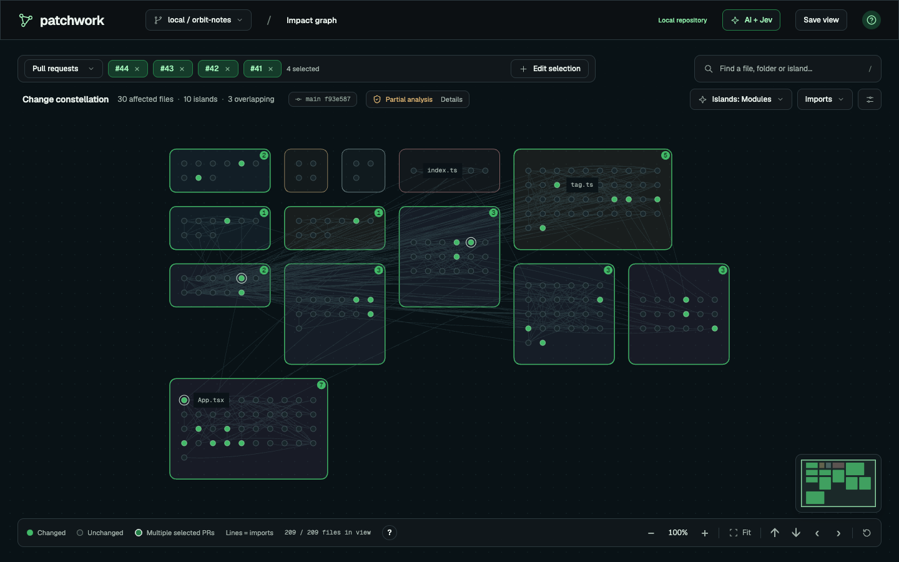
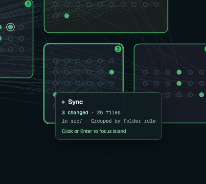
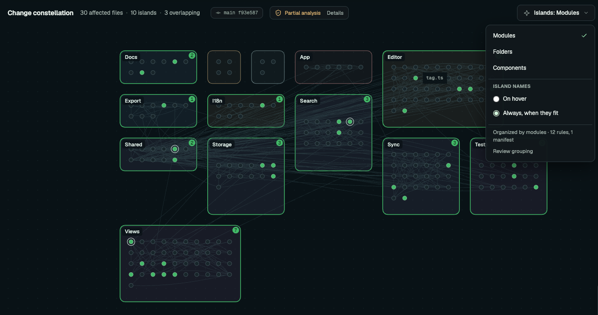
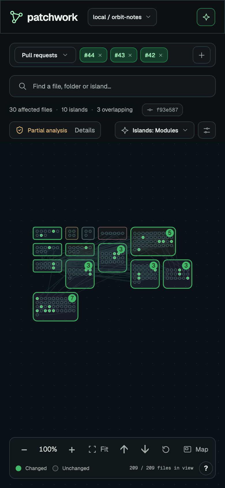
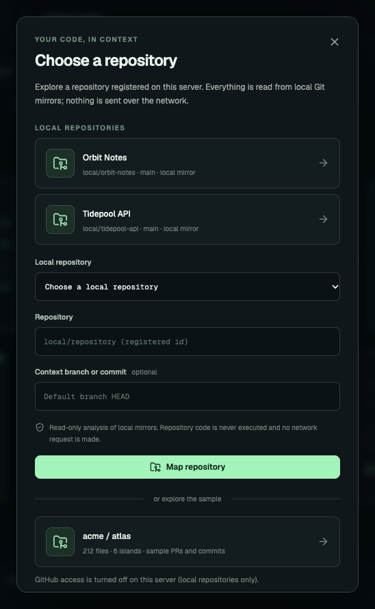
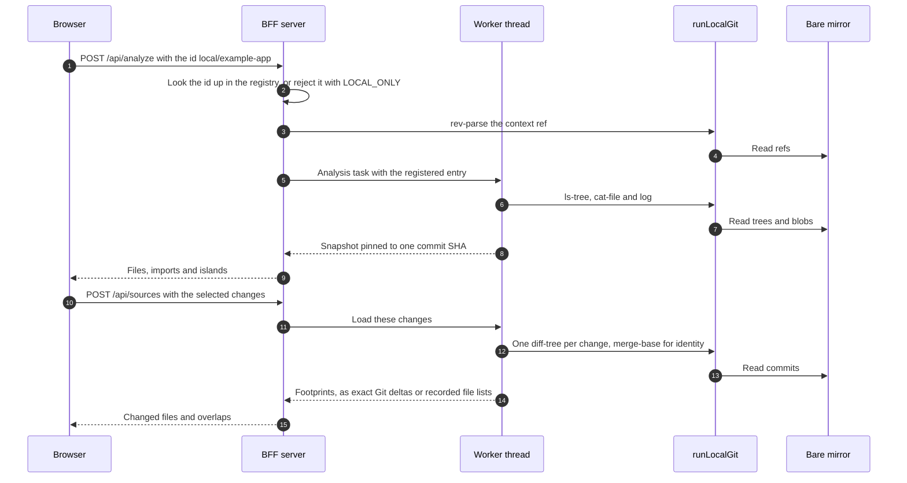
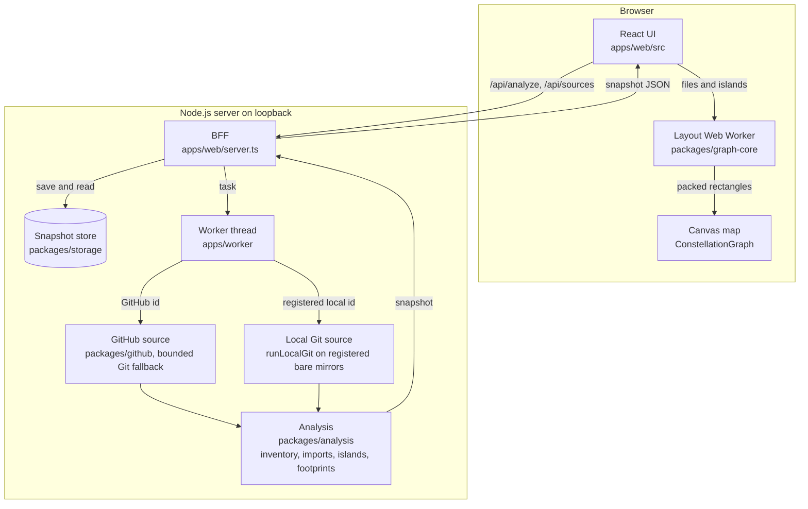

# Patchwork Constellation

See which parts of a repository a collection of pull requests or commits touches. Files are connected circles, and islands reveal modules, folders and components.



<sub>A made-up sample repository, `local/orbit-notes`, read offline from a local Git mirror. Four pull requests are selected; three files are touched by more than one of them.</sub>

This local-first web tool includes an interactive sample, public GitHub analysis, offline [local Git repositories](#local-git-repositories-offline), and optional read-only GitHub App authorization. It implements the second [Constellation Figma direction](https://www.figma.com/design/A7h1fCr1SbLPRwY4vstSup?node-id=17-2113). See [current completion decisions](docs/COMPLETION_STATUS.md) for verified scope and external AI gates; the [31-issue acceptance audit](docs/ISSUE_REMEDIATION.md) preserves earlier implementation evidence.

[Kanban board](https://github.com/users/oudaykhaled/projects/5) · [Issue index](planning/ISSUES.md) · [Verification](docs/VERIFICATION.md) · [Product requirements](docs/PRODUCT.md)

## Run locally

Use Node.js 24 and pnpm 11.25.0, then run:

```sh
pnpm install --frozen-lockfile
pnpm dev
```

Typechecking uses the pinned TypeScript 7 native CLI. The source analyzer and lint rules use Microsoft's pinned TypeScript 6 compatibility API side by side; TypeScript 7.0 does not expose the JavaScript compiler API they require.

Open **http://127.0.0.1:4310**. The sample opens without credentials or external model calls. The server binds to loopback and checks API Host/Origin headers. Hosted deployment needs the explicit proxy, account and release configuration described in the runbooks.

Stop either server with **Ctrl+C** in its terminal. To reset the default in-memory demo, stop and restart it, then open the root URL without saved-view query parameters. Configured PostgreSQL data and any explicit `GROUPING_STORAGE_PATH` are durable and are not erased by restarting.

`GET /api/health` checks the BFF; `GET /api/health/worker` starts the real analysis worker entry point without GitHub or provider calls. The worker probe is shared and cached for ten seconds. Invalid environment settings and unavailable configured startup services produce a readable configuration page and HTTP 503, with no credential values in diagnostics. Correct the configuration and restart the server.

`GET /api/readiness` additionally checks the real worker, storage, queue and production assets. Optional owner-scoped aggregate metrics and the verified local artifact/database rollback procedures are documented in [release operations](docs/RELEASE.md).

To serve the production frontend locally:

```sh
pnpm build
pnpm start
```

## Explore

1. Toggle sample PRs or switch to commits. Three PRs touch 68 files with 14 overlaps; removing #256 shows 57 files with two overlaps.
2. Drag, scroll or pinch the graph. Use +/−, Fit, pan buttons or arrow keys. Selecting changes preserves map positions.
3. Search for `refresh.ts`, inspect imports and source membership, or open the accessible file list. Sample diffs are labeled synthetic; analyzed GitHub repositories expose GitHub links, local repositories never do.
4. Choose a public GitHub repository, or a registered [local repository](#local-git-repositories-offline), and an optional context branch/commit. Analysis pins the context SHA, reports progress and exposes partial coverage. Select PRs or commits to load independent footprints.
5. Open AI + Jev to review availability, preview proposals, rename islands and undo corrections. The file inspector can move a file to another island.

The default desktop graph fills more than 80% of the viewport. Its layout settles; zoom and source selection remain dynamic.

## The map

Each island is a rounded rectangle. Its size follows its file count: the smallest square, or one module wider than tall, that holds every file. `packages/graph-core` packs the rectangles densely, first fit, and files sit on a lattice inside them.

- An island the selection changed has a green border and a badge with its changed-file count. An unchanged island is a quiet outline in its own colour.
- A filled circle is a changed file. An outer ring marks a file that two or more selected sources touched.
- Names are not painted on the map. Hover an island, after a short rest, or focus it with the keyboard. One tooltip shows its name, changed and total files, and how it was grouped.
- Click an island, or press Enter, to focus it. The camera fits the island and a breadcrumb names it. Search and Files name islands too.
- The islands are one Tab stop. Arrow keys move between them in reading order. Escape hides the tooltip and keeps focus.
- Controls stay off the islands. Selection and search sit above the map; the legend, zoom and pan sit below it. A minimap sits in the corner.
- Selecting changes keeps every position. If selection-only files would overflow an island, the map re-packs to the layout a direct load of the same files shows.



The **Island names** setting lives in the Islands menu. **On hover** is the default. **Always, when they fit** also draws each name inside its own rectangle, but only where it fits; small islands stay unnamed. The choice is remembered in this browser.



At phone width the controls stack above the map. Zoom, pan and the legend stay below it.



<sub>All screenshots show made-up repositories. They come from a server with only those repositories registered.</sub>

## Configuration

Copy `.env.example` to `.env` only when configuring optional services. Values stay server-side.

| Setting | Purpose |
| --- | --- |
| `GITHUB_TOKEN` | Optional token to increase public API quota; it does not authorize private repositories. |
| `GITHUB_APP_*`, `APP_ORIGIN` | Optional App login, repository-scoped tokens and current user-access checks. See [GitHub App setup](docs/GITHUB_APP.md). |
| `AI_ENABLED` | Defaults to false. External grouping must be explicitly enabled. |
| `TYPESAFE_API_KEY`, `JEV_MODEL` | TypeSafe Jev credentials and a pinned decision model. |
| `OPENAI_API_KEY`, `OPENAI_MODEL` | Generative adapter credentials and a pinned naming model. |
| `AI_EVALUATION_MANIFEST` | Reviewed, version-matched evaluation gate. Credentials alone cannot enable intelligence. |
| `AI_EXCLUDED_PATHS` | Additional comma/newline-separated exclusions for external metadata. |
| `DATABASE_URL` | Optional PostgreSQL storage; see [storage setup](docs/STORAGE.md). |
| `GROUPING_STORAGE_PATH` | Durable single-host grouping history; defaults to `.cache/grouping.json`. An explicit empty value disables file persistence. |
| `GITHUB_WEBHOOK_SECRET` | Enables signed, durably queued webhook processing when App authorization and PostgreSQL are configured. See [webhooks](docs/WEBHOOKS.md). |
| `PORT` | Local HTTP port; defaults to 4310. |
| `API_REQUESTS_PER_MINUTE` | Bounded local API request quota, 1–2400; defaults to 240. Browser test servers explicitly use 2400 for independent journeys. |
| `OPS_METRICS_ENABLED` | Defaults to false. Enables source-free operational aggregates; App mode requires a valid session and returns that owner's observations only. |
| `LOCAL_REPOS` | Absolute path to a JSON registry of bare Git mirrors. Turns on offline local Git mode; requires `AI_ENABLED=false` and no GitHub App settings. See [local Git repositories](#local-git-repositories-offline). |
| `LOCAL_REPOS_ONLY` | `true` or `false`; with `LOCAL_REPOS` set it defaults to true, and every unregistered repository is rejected with `LOCAL_ONLY` before any GitHub request. Set false to allow public GitHub repositories next to the local ones. |

The graph retains deterministic grouping until both providers and the reviewed evaluation gate are configured. External AI uses bounded metadata, validated IDs, reserved budgets, scoped caches and failure fallback. The current authored evaluation does not establish a navigation improvement; live intelligence remains gated. [Review the exact data policy](docs/AI_DATA_POLICY.md) before enabling external calls. Manual corrections persist separately and support revision conflicts, lineage review and undo.

## Local Git repositories (offline)

Map repositories that must not leave your machine. `LOCAL_REPOS` points to a JSON registry of bare mirrors (`git clone --mirror`). Registered repositories appear in the repository dialog next to the sample. An HTTP request can only name a registered id such as `local/example-app`, never a path.



Make a mirror, write a registry, and start the server with it:

```sh
git clone --mirror /path/to/example-app /abs/mirrors/example-app.git
LOCAL_REPOS=/abs/repositories.json pnpm dev
```

The smallest registry names one mirror:

```json
{
  "version": 1,
  "repositories": [
    { "id": "local/example-app", "label": "Example app", "gitDir": "/abs/mirrors/example-app.git", "defaultRef": "main" }
  ]
}
```

Open the repository dialog and pick **Example app**. Commits come from the first-parent history of the context. Pull requests and prepared views come from an optional footprint file; see the [registry reference](#registry-reference).

### Zero egress

With `LOCAL_REPOS` set, `LOCAL_REPOS_ONLY` defaults to true. The server then makes no outbound request:

- An unregistered repository id is rejected with `LOCAL_ONLY` before any GitHub request.
- The server refuses to start with `AI_ENABLED=true` or with GitHub App sign-in.
- Git runs only through `runLocalGit`. It allows eight read-only plumbing commands (`rev-parse`, `for-each-ref`, `ls-tree`, `cat-file`, `log`, `rev-list`, `diff-tree`, `merge-base`) with `shell: false`, a scrubbed environment, no hooks, no credential helper and `protocol.allow=never`. Arguments that could write a file, run a program or name a transport are refused.
- Links use `local-git://` and never point to github.com. The page loads only its own bundled assets.
- Git diagnostics are never shown. Configuration problems name the repository id and the field, never a path.
- A test runs the analysis worker thread with `fetch`, sockets, TLS and DNS blocked. Analysis and source loading must not attempt a single request (`tests/api/local-mode.test.ts`).

Set `LOCAL_REPOS_ONLY=false` to allow public GitHub repositories next to the local ones. Only GitHub ids then reach GitHub; local ids stay on their mirror.

### How a local request flows



The browser never sees a mirror path. Requests, responses and links carry only the registered id.

### Registry reference

```json
{
  "version": 1,
  "limits": { "maxFiles": 8000, "workerHeapMb": 768 },
  "repositories": [
    { "id": "local/example-app", "label": "Example app", "gitDir": "/abs/mirrors/example-app.git", "defaultRef": "main",
      "include": ["src/**"], "exclude": ["**/generated/**"], "mapping": "/abs/example-app.constellation.json",
      "footprints": "/abs/example-app.footprints.json", "footprintRepos": ["example-app"], "limits": { "maxFiles": 5000 } }
  ]
}
```

- The server reads the registry, mappings and footprint files once at startup and hands each worker thread the registered entry it needs; restart the server after editing them.
- `id` (owner/name form), `label`, `gitDir` and `defaultRef` are required; relative paths resolve against the registry file.
- `mapping` is an out-of-repository `.constellation.json` (version 1) that replaces in-repository island mapping.
- `footprints` is a JSON file `{ "schemaVersion": 1, "pulls": [...], "commits": [...], "views": [...] }`. A pull is `{ "number", "title", "state", "updatedAt", "baseSha", "headSha", "origin", "repo", "notes", "files" }` and a commit is `{ "sha", "title", "updatedAt", "origin", "repo", "notes", "files" }`; only `number` or `sha` is required. A file row is `{ "path", "status", "additions", "deletions", "previousPath", "inHead", "note" }`, where `status` is a full name or a Git name-status letter. A view is `{ "id", "title", "description", "sources": [{ "kind": "pr" | "commit", ...a pull or commit }] }`; a view source may also reference a listed pull or commit by its `number` or `sha` alone. With `footprintRepos`, only records whose `repo` equals a listed name, or starts with a name that ends in `*`, are kept, so one file can serve several mirrors. A record becomes an exact Git delta when its commits are in the mirror, a recorded footprint (comparison kind `recorded`, partial coverage naming its origin) when only a file list exists, and an unloaded entry with an explicit reason otherwise. Views become one-click selections in the sources dialog. When rename history from another loaded change links two rows of one footprint to the same file (for example a case-only rename recorded as a removal plus an addition), the rows are shown as one change and the source names each merge as a coverage reason.
- File identity follows the mirror's history, not the IDs or the order in which changes are selected (together or one at a time). Selected changes load anchored at the context: commits the context contains load newest first, so their renames chain back to the context file; other commits (other branches) load oldest first from where they left the context's history, so an addition maps before later edits; recorded footprints load in ID order. Same-path files outside the context are then matched by `merge-base` of the two heads: on one line of history a path is one file, and an addition on a separate branch is a separate file. Recorded footprints have no history in the mirror, so their same-path matching follows the path rules. GitHub mode is unchanged.

### Limits

- Global `limits` default to `{ "maxFiles": 10000, "maxSourceFiles": 500, "maxSourceBytes": 80000, "maxManifests": 50, "maxSnapshotBytes": 67108864, "workerHeapMb": 1024, "maxChangedFiles": 25000, "maxListedSources": 1000 }` (`LOCAL_LIMIT_DEFAULTS`).
- Limits are bounded (`maxFiles` ≤ 25,000, `maxSourceFiles` ≤ 500, `maxSnapshotBytes` ≤ 64 MiB, `workerHeapMb` ≤ 2,048); per-repository `limits` override the global ones except the snapshot and heap ceilings. `maxSnapshotBytes` and `workerHeapMb` apply to local repositories only; GitHub snapshots keep the 16 MiB store limit and the 256 MB worker heap when `LOCAL_REPOS_ONLY=false`. Scope filters, inventory caps (naming the folders an alphabetical cut removed), unsupported languages and recorded footprints all appear as coverage reasons.
- Each selected change is compared with one `git diff-tree` run. Rename detection is bounded (Git's `diff.renameLimit` of 1,000); when Git skips it, the change says so in its coverage. A change over `maxChangedFiles`, or one Git cannot compare within its time or output budget, fails on its own with a reason while the other selected changes still load. Recorded footprint rows obey `maxChangedFiles` too. Cancelling or replacing a request stops its Git processes.
- A registry lists at most 32 repositories. At most 20 changes can be selected together.
- Imports are read from JavaScript and TypeScript only. Other files appear without connections, counted by type in the coverage.

## Analysis boundaries

Public repository inventory defaults to 2,000 files and parses at most 120 JavaScript/TypeScript files, with 80 KB per source blob. Local repositories have their own [limits](#limits). Unsupported languages, unresolved imports, API limits and truncated trees produce explicit coverage reasons. Import edges describe static review context rather than proven runtime impact. At most 20 sources can be selected together.

Each PR uses its own pinned comparison; each commit uses its first-parent delta. Their union highlights touched files and overlapping sources without creating a merged code state.

Optional App authorization, bounded bare-Git fallback, separate selected-head import layers, durable job recovery and signed webhook refresh are implemented. Refresh leaves the active map in place until explicitly applied. Coverage and resource limits remain visible; imported repository scripts and dependencies are never executed.

Real PostgreSQL checks include coordinator termination, lease recovery, stale-write rejection and durable webhook restart. Live App registration/delivery, human accessibility review, model evaluation and hosted release checks remain explicit gates. See the [acceptance audit](docs/ISSUE_REMEDIATION.md), [database evidence](docs/evidence/postgres-local.json) and [security review](docs/SECURITY_REVIEW.md).

## Checks

```sh
pnpm check
pnpm exec playwright install chromium firefox webkit
pnpm test:e2e
```

`pnpm check` runs type checks, unit/integration tests and the production build. Browser tests cover selection, camera behavior, file inspection, recovery, grouping undo, viewport area and narrow/reduced-motion interaction. To use an installed Chrome for local Chromium checks, set `PLAYWRIGHT_CHROME=1` and run `pnpm test:e2e --project=chromium`.

CI uses read-only repository permissions, pinned actions, no deployment credentials and bounded failure-artifact retention. Hosted CI and required repository checks must be verified on GitHub; authoring a workflow does not enable branch protection.

## Source layout

The TypeScript workspace contains the React frontend/BFF in `apps/web`, job orchestration in `apps/worker`, and packages for contracts, fixtures, layout, GitHub, source analysis, grouping and storage. [Architecture](docs/ARCHITECTURE.md), [roadmap](docs/ROADMAP.md) and [contribution instructions](CONTRIBUTING.md) explain the boundaries.

The browser talks only to the BFF. The BFF hands analysis to a worker thread, which reads either GitHub or a registered local mirror. Both sources feed the same analysis, so a local snapshot has the same shape as a GitHub one. Layout runs in the browser, in a Web Worker, and the Canvas map draws the result.



## License

Licensed under [Apache License 2.0](LICENSE), selected by the repository owner on 2026-11-03. Third-party dependencies retain their own licenses.

The frontend and distributed fonts retain the exact installed [third-party license notices](apps/web/public/THIRD_PARTY_NOTICES.txt), with [package/version/source digests](apps/web/public/THIRD_PARTY_NOTICES.json). Builds verify these notices and copy them into `dist`; Geist and Geist Mono remain under OFL-1.1.

See [final integrated verification](docs/FINAL_VERIFICATION.md) for the 31-issue acceptance audit, current production measurements, incremental refresh and publication status.

The complete implementation is published in [PR #32](https://github.com/oudaykhaled/patchwork-constellation/pull/32). [Current publication verification](docs/PUBLICATION_STATUS.md) records the hosted three-engine/budget checks and nine remaining acceptance gates.
